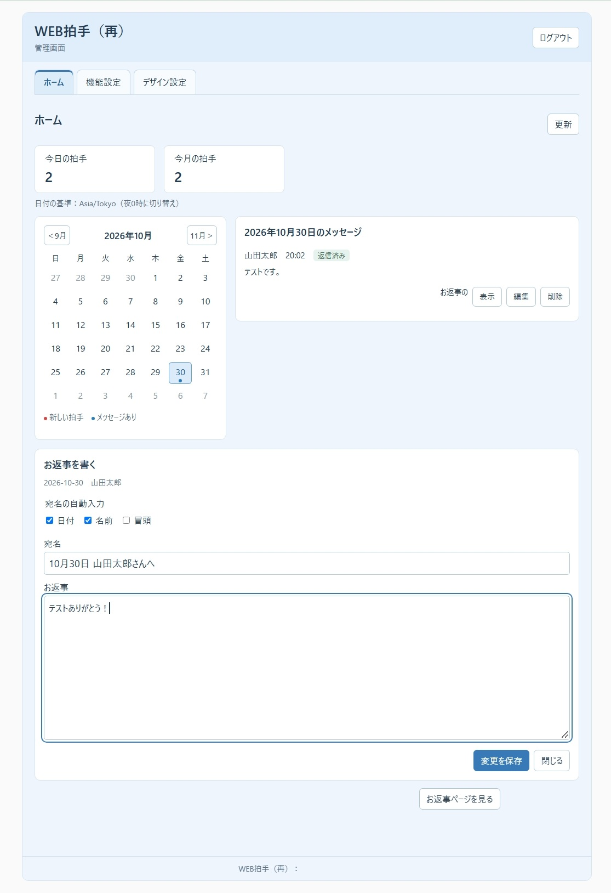
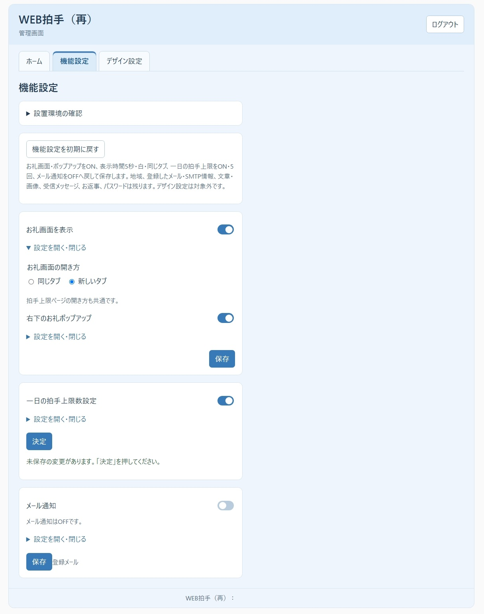
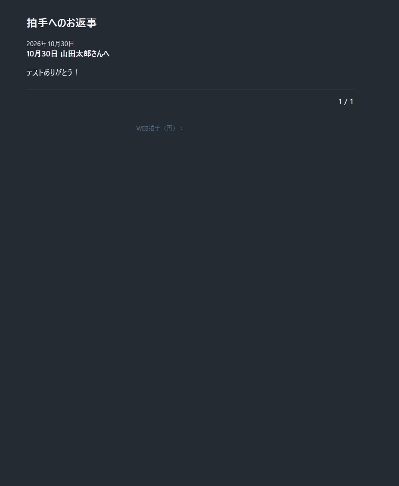
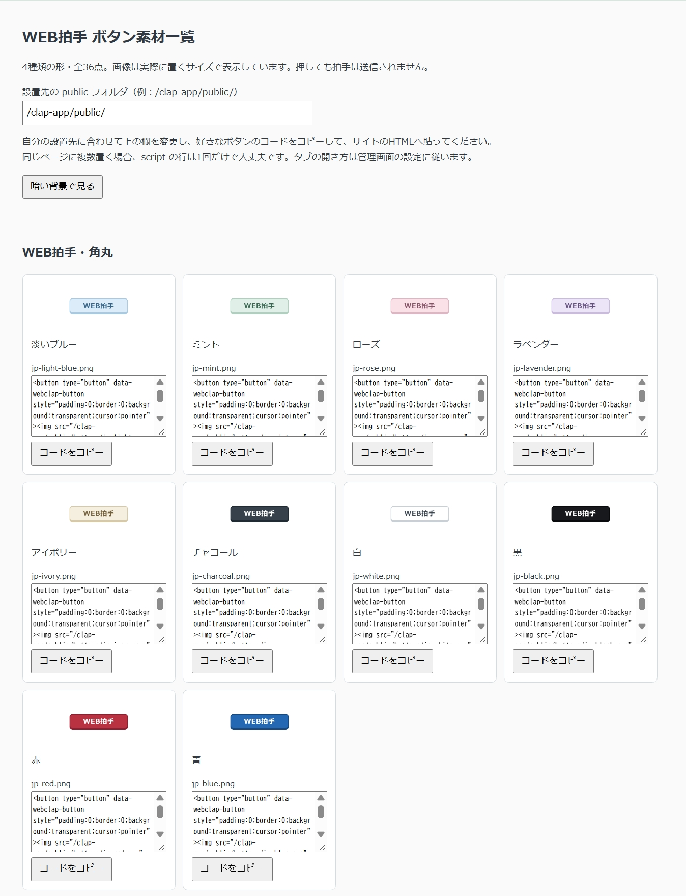
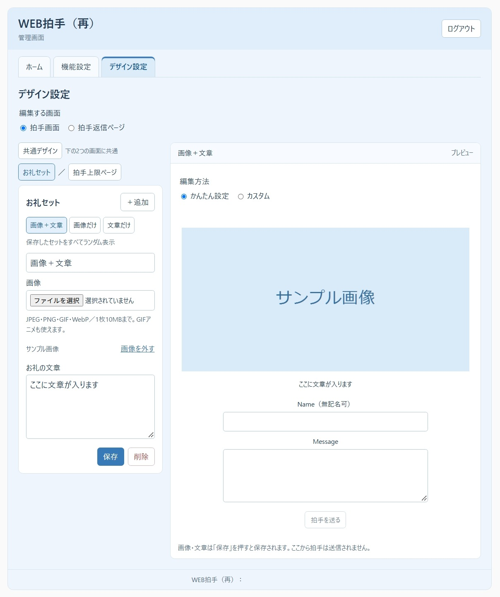

# Web Clap (Again)

## Bring a little love back to your personal website.

**Heisei-era internet culture lives again!**

Milestone visitor counters! Hit-and-run visits! Drawing chats! Fan alliances! Link exchanges!

And at the heart of it all: **personal websites!**

They're not dead.

**Neither is Web Clap.**

＼ Clap clap clap clap ／

"I read it." "I love this." "Can't wait for the next update."

You don't quite have a whole review to write. You don't especially want to leave your name.

But **you kind of want to press something.**

That button. The one for moments like these.

**Web Clap (Again)** is a tool you install on your own website to receive claps and messages from visitors.

It isn't a social network. It isn't a contest for the most likes.

It's a small doorway to connection, tucked into a corner of your site, where someone can simply say:

**"That was good."**

If you remember those days, welcome back.

And if you don't:

**Personal websites helped Japanese otaku culture grow. Want to experience a little of that connection for yourself?**

So, yes:

**Japanese and English versions are both available.**

---

## Screenshots (Japanese edition)

**Screenshots show the Japanese edition using test data.** The download on this page is the English edition. Some information has been hidden for publication.

<h3>More screenshots: dashboard, feature settings, replies, and button gallery</h3>

### Dashboard and reply editor

### Feature settings

### Public replies page (dark theme)

### Button gallery and copyable embed codes (excerpt)

### Design settings and thank-you preview

---

## What it does

- 👏 **Receive claps**  
  Visitors can send a clap without writing a message.
- 💬 **Receive messages, with or without a name**  
  Anonymous messages are welcome.
- 📅 **Check your clap counts**  
  View today's claps, the monthly total, and claps and messages by date using the calendar.
- 🎁 **Show a thank-you after a clap**  
  Use an image, text, or both. Save multiple thank-you sets for random selection.
- ✉️ **Reply to messages**  
  A page for publishing your replies is included from the start.
- 📧 **Get email notifications**  
  Receive a notification when a clap includes a message.
- 🎨 **Change the look**  
  Use the supplied themes or customize pages with HTML and CSS.
- 🌏 **Choose your time zone**  
  Count claps with **each new day starting at midnight in your chosen time zone**.

**Take Heisei-era culture worldwide.**

From Japan or anywhere else, count today's claps by the time your website calls home.

---

## "The site with the clap-button graphics is gone! > <"

Time can be cruel.

However:

# NO PROBLEM ✋

**For a limited time only!!**

...Just kidding.

We've included **36 clap-button graphics, too. ^^**

There's no extra charge, of course. The app itself is free as well.

Pick your favorites and use them.

Preview the 36 included button graphics

| | | | | |
| --- | --- | --- | --- | --- |
|  |  |  |  |  |
|  |  |  |  |  |
|  |  |  |  |  |
|  |  |  |  |  |
|  |  |  |  |  |
|  |  |  |  |  |
|  |  |  |  |  |
|  | | | | |

Enter your installation path in the button gallery to generate the embed code.

**"I installed Web Clap. But I don't have a button to press."**

Even if you've just returned to the internet after a very long Heisei-era nap, we've got you covered.

---

## Your personal website's little connection kit. All in one.

There's more in the box than a clap counter.

**In this one package:**

- **Clap-button graphics**
- **A page for replying to messages**
- **A simple thank-you popup after a clap**

**They're all included.**

Hunting down a graphics site, building somewhere else to post replies, putting together a thank-you page...

**You can skip all that.**

Take one ZIP home with you.

A small connection kit for a corner of your personal website.

**We've packed it all into one box. ^^**

---

## A database?

**You don't need one.**

Claps, messages, settings, and other data are stored within the installed app's folder.

The main requirements are:

- **PHP 8.3 or later**
- **HTTPS**
- An Apache-compatible environment that enforces the bundled **`.htaccess` access restrictions**
- Writable file storage with file locking
- PHP **Fileinfo**
- **OpenSSL / SMTP sending** if you want email notifications
- **cURL**, depending on your server configuration

The first-time setup includes a check to see whether your hosting environment is suitable.

Hosting services that cannot run PHP or do not enforce the required access restrictions cannot run this app as-is.

---

## Download

Download the ZIP for your preferred language from GitHub **Releases**.

| File | Language |
| --- | --- |
| [WEBclap-sai-1.0.0-ja.zip](https://github.com/Geek0426/WEBclap/releases/latest) | Japanese |
| [WEBclap-sai-1.0.0-en.zip](https://github.com/Geek0426/WEBclapEnglish/releases/latest) | English |

[日本語版 / WEB拍手（再）](https://github.com/Geek0426/WEBclap)

The ZIP contains the `webclap-sai` app folder and a guide.

After extracting it, start by opening **説明書.html** for Japanese, or **Guide.html** for English.

**Even if you're the type who charges in without reading the instructions, please read them first this time.**

Installation, requirements, usage, backups, and terms of use are all in there.

---

## Important installation notes

This package is for a **new installation**.

Please don't overwrite an old Web Clap installation or another app's folder with a casual:

**"It'll probably be fine."**

**It won't.**

Upload the `webclap-sai` folder into a new, empty location.

Remember to upload the hidden **`.htaccess` files**, too.

The page with your clap button and Web Clap (Again) must use **the same domain and protocol**.

Cross-domain embedding is not supported.

See the included guide for the full installation steps.

---

## Tested environments

The Japanese edition has been tested in the creator's Sakura Rental Server test environment: initial setup, claps, messages, email notifications, replies, images, and custom pages.

Both Japanese and English editions have automated tests in a local environment.

The English edition has not been tested on a live hosting server.

Other hosting providers, execution on PHP 8.3 / 8.4, actual smartphones, and installation through the WordPress editor have not been verified. Local automated tests use PHP 8.5.7.

**Say where it worked. Don't pretend to have tested what you haven't.**

We're keeping that part honest.

---

## Terms of use

Copyright in the original portions of Web Clap (Again) belongs to its creator, **Yuzu (ゆず)**.

- You may install and use the app on your own website.
- You may change settings in the admin area, edit HTML and CSS through the supported custom features, and adapt the embed code to your installation.
- You may use the bundled button graphics as clap buttons on your own website.
- **Redistribution or republication of the app and its bundled original assets, and modification of the app itself, are prohibited.**
- Third-party libraries and assets are governed by their respective licenses.
- Rights in images and text you provide remain with their respective rights holders.

See the included guide for full terms and third-party credits.

---

That one clap you left on somebody's website, all those years ago.

Why not put a button on your own site this time?

**For the love you haven't put into words yet, one click is enough.**

**Web Clap (Again)**
